# PhotoHub

**One window for your whole photo life on the Mac: the archive folders in iCloud Drive and the Photos library from your phone, with every RAW, edit and export of a shot stacked together.**

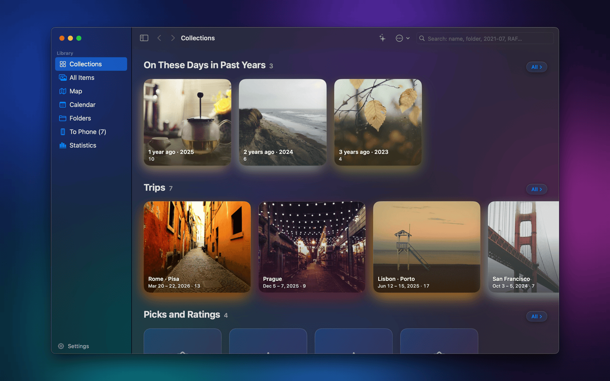

PhotoHub is a native macOS app that catalogs what you already have where it already is. It does not import, copy or reorganize anything by itself, and it does not download your iCloud files to show them.

## Why

- Your archive is split: camera shoots, RAW files and Lightroom exports sit in folders in iCloud Drive, phone photos live in the Photos library, old backups are somewhere else.
- One shot exists five times: the RAW, the camera JPEG, two edits and an export. Finder shows five files, Photos shows none of them.
- There are duplicates you cannot see: copies dragged out of Photos, the same folder copied twice.
- There is no single place to browse it all by trip, person or year, and every app that offers one wants to import and own your files.

## What it does

**Collections, like in Photos.** Trips, people and pets, events, places, years, cameras, "On These Days in Past Years", and "To Sort Out" lists (RAW without edits, edits not on the phone, shots without an exact date, copies) — across the archive and the Photos library together.

**Folders, like in Finder.** Browse the archive by its real folder structure, with a path bar and the usual sorting.

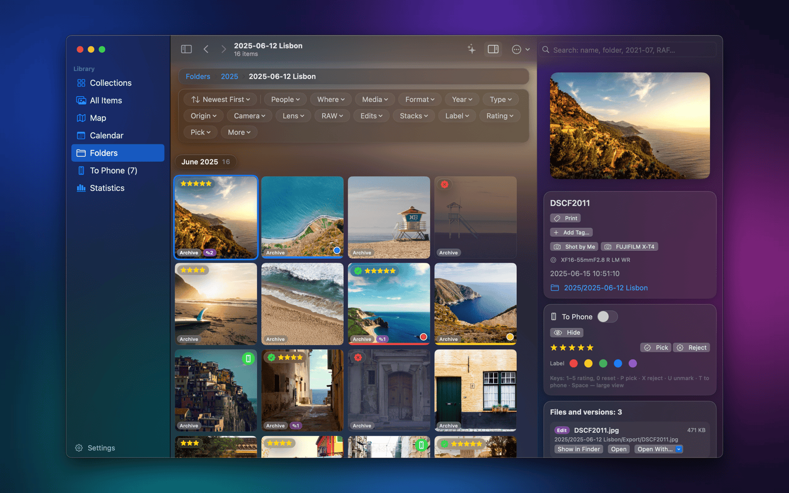

**Stacks of versions.** The RAW, the camera JPEG, Lightroom and Photoshop edits, exports and the copy in Photos are one tile. Open it to page through the versions, compare an edit with the original and zoom to 100 %.

<p>
  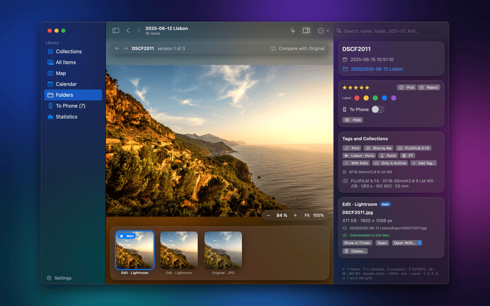
  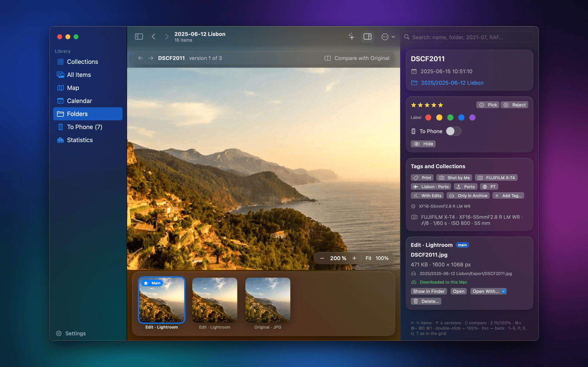
</p>

**Trips, places and a map.** Trips are detected from where and when you shot: everything away from home in a row becomes one trip, named after its cities.

<p>
  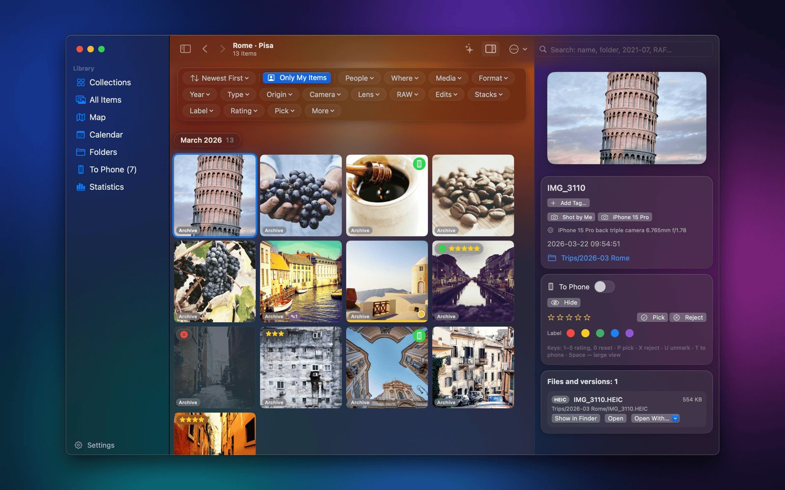
  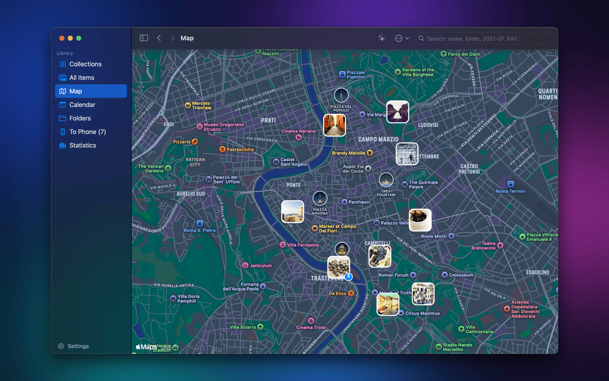
</p>

**People and pets.** The people and pets you named in Photos, with "With Me" and "Without Me" filters. A local face model suggests names for archive shots that Photos never saw (preview, command line for now).

**Labels, ratings and picks, like in Lightroom.** Stars on 1–5, pick and reject on P and X, color labels on 6–9; filter and sort by them, or "Select All with Label". They are stored in PhotoHub's catalog and never written into your files.

<p>
  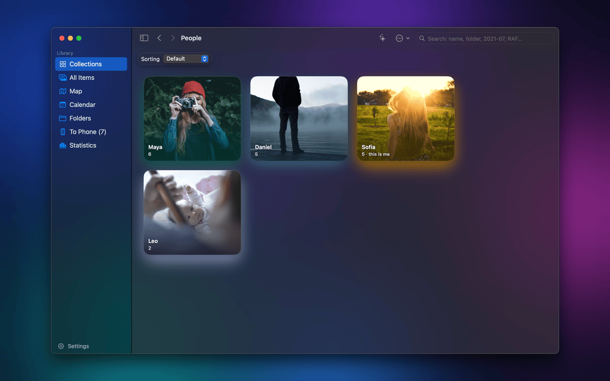
  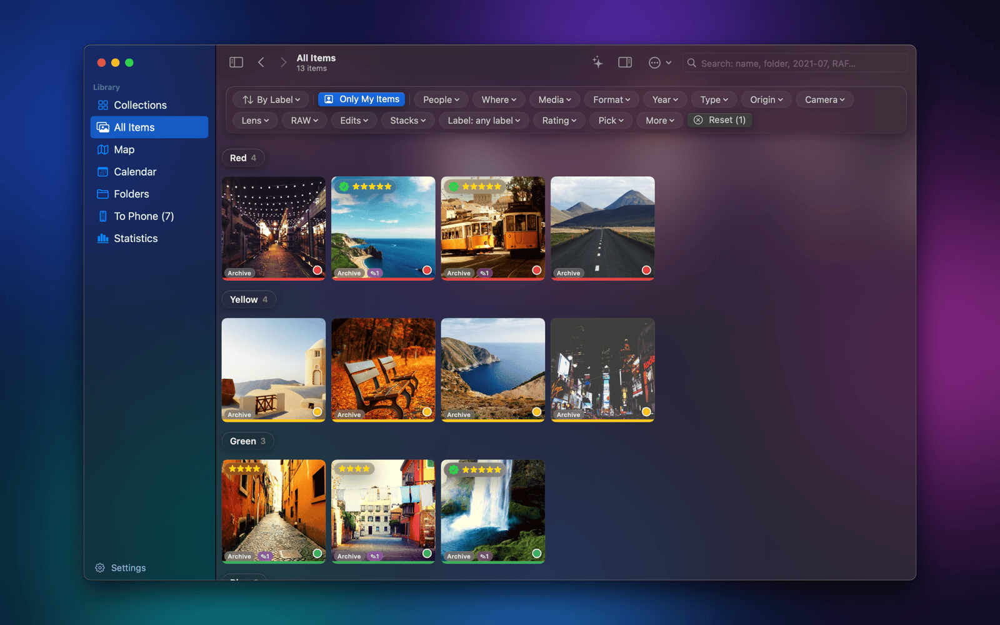
</p>

**Calendar and statistics.** A calendar by day, week, month and year, with a cover for every day you shot and trips drawn as bars under their days. Statistics count shots, files, edits, copies and space, chart shots per year and month, and list the top cameras, lenses, people and places.

<p>
  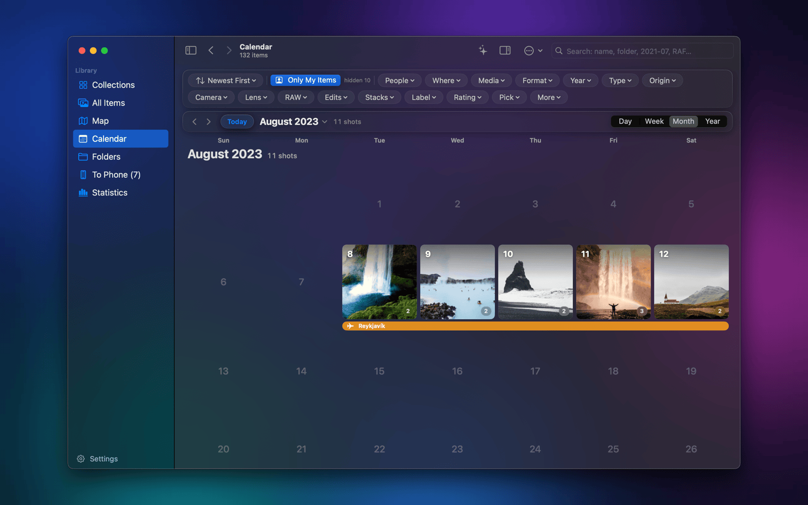
  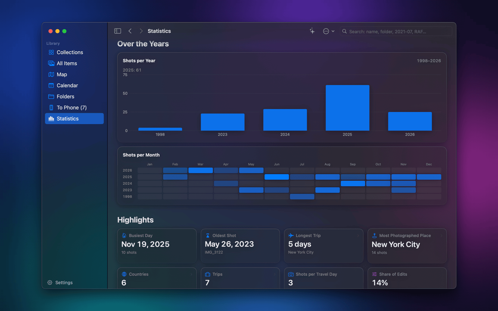
</p>

**Tags and Hidden.** One picker adds tags, people and pets to the selected shots, from the keyboard or with a click. Hide shots or whole folders like the Hidden album in Photos; the Hidden collection opens with Touch ID or your password.

<p>
  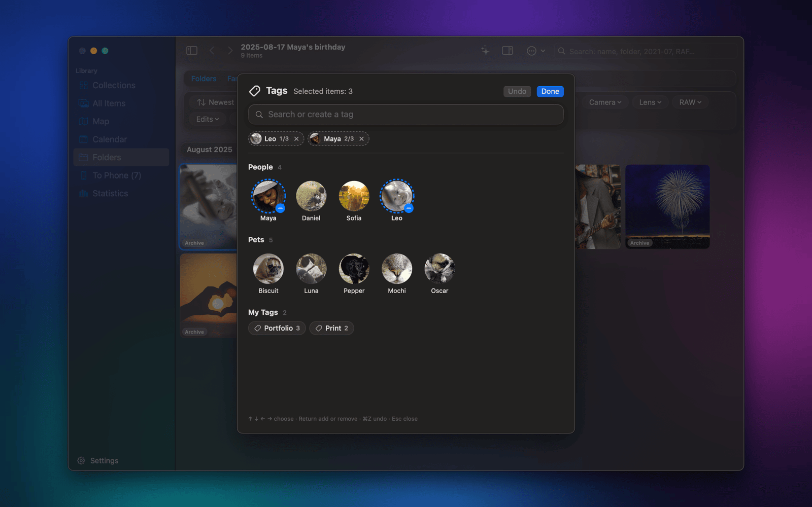
  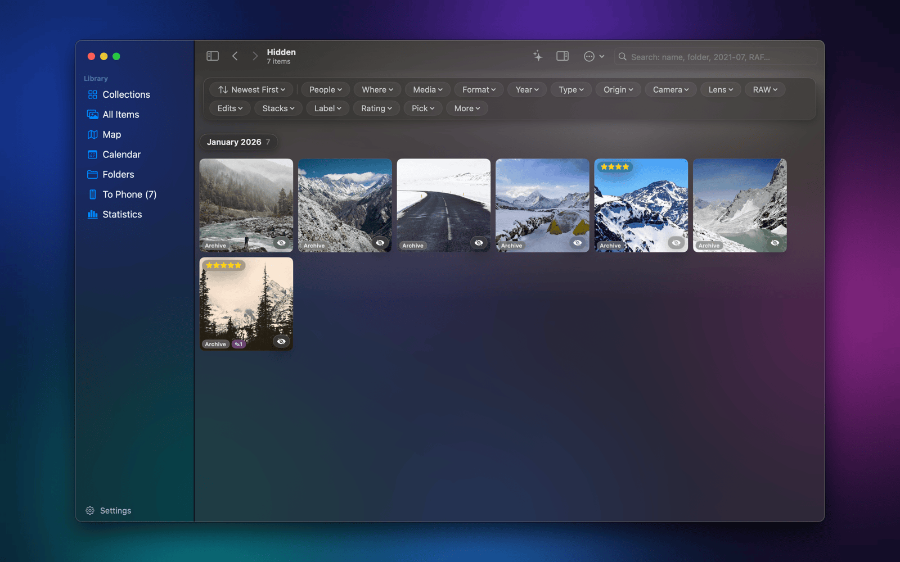
</p>

**Exact copies and safe deletion.** Byte-identical files are found by their hash. Deleting always shows one confirmation with every file, folder and size involved; archive files go to the Trash (or iCloud Drive's "Recently Deleted"), Photos items go to "Recently Deleted".

**Send to the phone, add to the archive.** Mark shots "To Phone" and send the best version of each into a Photos album named after the event. A shot that exists only in Photos can be copied into an archive folder PhotoHub suggests.

**Recognition and search on the Mac (preview).** Apple Vision labels make the archive searchable in English and Russian ("dog", "cats", "закат на море"), Vision fingerprints find similar shots and lost edits, and the bundled SFace model recognizes your people. All of it runs offline; for now it is a command-line tool, the app integration is on the [roadmap](ROADMAP.md).

**An agent in the app (optional).** Ask in plain words: "tag these as Portfolio", "move the selected shots to Trips/2025-12 Vienna", "shift the dates of the X100 shots by one hour". Moves and date changes always show a plan first and run only after you say yes. It uses your own Claude Code login.

**English and Russian.** The interface follows the macOS language or the choice in Settings.

<p align="center">
  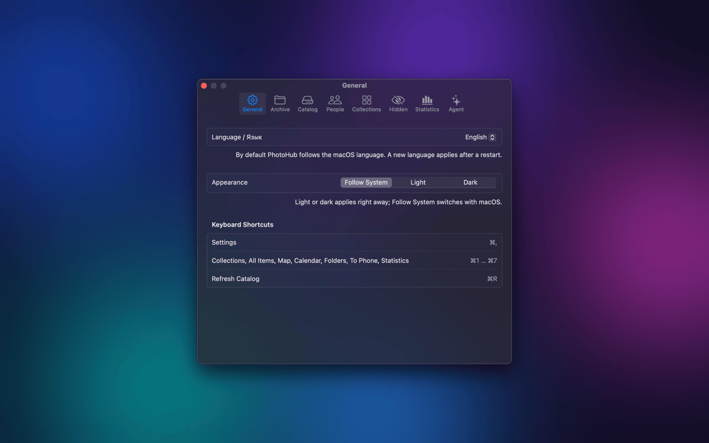
</p>

## Who it's for

- **A photographer with a Mac.** RAW files and Lightroom or Photoshop exports in iCloud Drive, the phone's shots in Photos, and no wish to import everything into yet another library.
- **Someone merging lives.** Phone photos, old camera folders and backup copies that need to become one browsable archive, without moving a file until you decide where it goes.
- **Someone cleaning up.** Duplicates, copies dragged out of Photos, rejected shots and edits that never reached the phone, found and removed with a confirmation and a way back.

## Privacy

- Everything runs on your Mac: the catalog, previews, face data and settings stay in `~/Library/Application Support/PhotoHub`.
- PhotoHub uploads nothing. The only network traffic is what macOS already does: iCloud Drive and iCloud Photos sync, and Apple Maps tiles.
- The Photos library is read, not modified, except when you send shots to it or delete them with a confirmation.
- The agent is optional and sends only what you type and the names of the selected shots, through your own Claude Code account.

See [SECURITY.md](SECURITY.md) for details.

## Requirements

- macOS 13 Ventura or later; developed and tested on macOS 15 on Apple silicon.
- Xcode Command Line Tools (Swift 5.10 or later) to build the app.
- [uv](https://docs.astral.sh/uv/) with Python 3.14 for the catalog backend (it moves into the app over time, see the roadmap) and [ExifTool](https://exiftool.org/) for reading camera data.
- Optional: the [Claude Code](https://claude.com/claude-code) CLI, logged in, for the agent.

## Getting started

```sh
git clone <repository-url> photohub && cd photohub
uv sync
scripts/build_app.sh
```

Open PhotoHub, choose your archive folder in Settings → Archive and press "Rebuild Catalog". Then make previews with `.venv/bin/photohub scan`. The [GUIDE](GUIDE.md) covers signing, permissions, the first scan, keyboard shortcuts and troubleshooting.

## Try the demo

```sh
scripts/demo.sh
```

It downloads about 140 free stock photos from Unsplash, builds a demo archive with trips, edits, copies and people in `/tmp/photohub-demo`, and opens a separate demo copy of the app on it. Your own catalog and Photos library are not touched. The screenshots above come from it (`scripts/screenshots.sh`).

## Status and roadmap

PhotoHub is a working personal tool that is being opened up. It is used daily on a library of about 25,000 shots, but it is young: the catalog still builds through a Python backend, and some features are command-line only. See the [ROADMAP](ROADMAP.md) for what comes next: the catalog in Swift, auto-update, "Find Similar" and search in the app, failed-shot detection and an undo for every action.

Contributions are welcome — see [CONTRIBUTING.md](CONTRIBUTING.md).

## License

PhotoHub is released under the [MIT License](LICENSE). Bundled and downloaded third-party components, including the SFace face model (Apache 2.0), are listed in [THIRD_PARTY_NOTICES.md](THIRD_PARTY_NOTICES.md).
